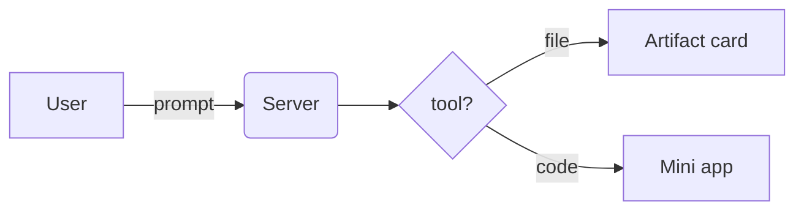

# GFM Showcase

A **GitHub-Flavored Markdown** kitchen-sink — every element the viewer should handle, in one file. *Italic line*, normal line.

## Headings

# H1 — the title
## H2 — section
### H3 — subsection
#### H4 — minor
##### H5 — rare
###### H6 — smallest

Setext H1
=========

Setext H2
---------

## Emphasis

*italic* and _italic_ · **bold** and __bold__ · ***bold italic*** and ___bold italic___ · ~~strikethrough~~ · **bold with _italic inside_** · a literal \*asterisk\* and \_underscore\_ and \`backtick\` escaped.

## Quotes

> A single-line blockquote.

> A longer quote that wraps onto
> a second line of the same block.
>
> > Nested quote inside it.
>
> — back to the outer level, **bold** in a quote, `code` in a quote.

## Lists

### Unordered

- Dash item
- Star item
* Second star
+ Plus item
  - Nested dash (2 spaces)
    - Deeper nest (4 spaces)
- Back to top level

### Ordered

1. First
2. Second
   1. Nested decimal
   2. Another nested
      - Mixed bullet under ordered
3. Third
10. Tenth (loose numbering)

### Tasks

- [x] Done task
- [ ] Open task
- [x] ~~Done and struck~~
  - [ ] Nested open task

## Code

Inline `code span` and ``a span with `backticks` inside``.

Indented block:

    fn indented() -> bool { true }

Fenced, with languages:

```rust
fn main() {
    let xs: Vec<i32> = (1..=10).filter(|x| x % 2 == 0).collect();
    println!("{xs:?}");
}
```

```tsx
export default function Card() {
  const n = signal(0);
  return <View onPress={() => n.update(v => v + 1)}><Text>{n()}</Text></View>;
}
```

```python
def fib(n):
    a, b = 0, 1
    for _ in range(n):
        a, b = b, a + b
    return a
```

```bash
cargo build --target aarch64-apple-darwin && ./target/debug/rox
```

```json
{ "name": "rox", "kind": "native", "targets": ["macos", "ios"] }
```

```diff
- removed_line();
+ added_line();
  context_line();
```

```
Plain fenced block — no language, no highlight.
```

## Tables

| Left | Center | Right |
|:-----|:------:|------:|
| a | b | c |
| **bold** | `code` | ~~gone~~ |
| one | two | three |

| A table with an \| escaped pipe | Works? |
|---|---|
| cell | yes |

## Links

[Inline link](https://github.com) · [titled link](https://github.com "GitHub") · [reference link][gh] · [shortcut ref][gh] · autolink <https://github.com/longbridge/nsh> · bare www.example.com · <mailto:hi@example.com> · email bare: hi@example.com · [section anchor](#tables)

[gh]: https://github.com "the forge"

## Images


## Horizontal rules

Above, three styles:

---
***
___

## Footnotes

A claim with a footnote.[^1] Another one.[^long]

[^1]: The footnote body — *formatted*.
[^long]: A longer note with a second paragraph.

    Indented continuation of the note.

## Alerts (GitHub admonitions)

> [!NOTE]
> Useful information to skim.

> [!TIP]
> A helpful trick.

> [!IMPORTANT]
> Don't miss this.

> [!WARNING]
> Careful with this step.

> [!CAUTION]
> This can break things.

## HTML

<details>
<summary>Collapsible details block</summary>

Markdown inside details still renders: a **bold** claim, `code`, and a list:

- item one
- item two

</details>

Inline HTML: <sub>subscript</sub>, <sup>superscript</sup>, <kbd>⌘K</kbd>, <mark>marked</mark>, <ins>inserted</ins>, H<sub>2</sub>O, x<sup>2</sup>.

## Extras GitHub renders

- Emoji shortcodes: :rocket: :tada: :bug: :white_check_mark:
- A mention @someone and an issue ref #123 (plain text outside GitHub)
- Color chips in code spans: `#0969DA` `#f5f5f5`
- Math inline $E = mc^2$ and a block:

$$ \int_0^\infty e^{-x^2}\,dx = \frac{\sqrt{\pi}}{2} $$

## Diagrams



## Misc

An invisible HTML comment should not show:
<!-- nothing to see here -->

Soft line break
becomes a space. A hard break follows this line  
on its own line. Backslash break\
here too.

A paragraph with *many* **mixed** ~~styles~~ `and` [links](https://example.com) in one run to check inline merging.
